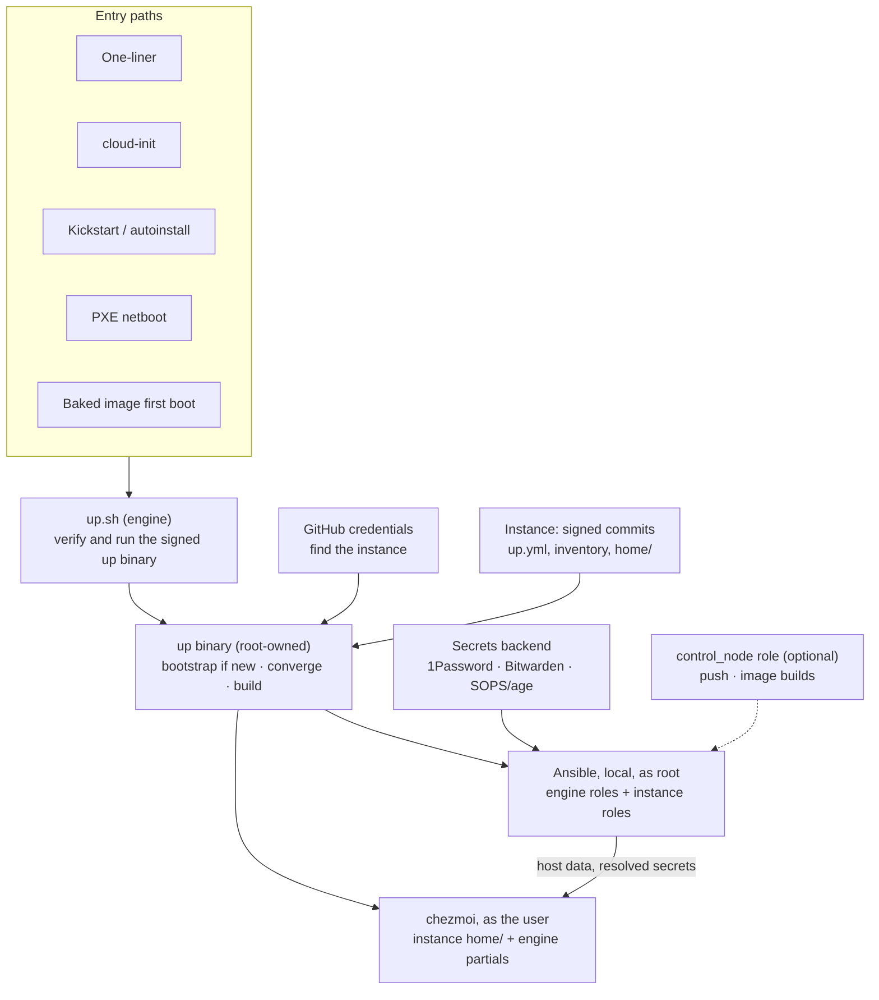

# Architecture

Two repos, one binary, five layers. The public engine holds everything reusable, including the source of the `up` binary; a separate instance repo holds everything personal. On a host, root runs only verified, root-owned copies of both under `/opt/up` (see [trust.md](trust.md)); people edit in ordinary working clones that root never reads. Every provisioning path ends in `up`, and every host runs its own Ansible locally.



## Engine and instance

| | Engine (public `<you>/up`) | Instance (`<login>/<name>`, private) |
| --- | --- | --- |
| Holds | Source of the `up` binary (Rust), generic roles, lookup plugins, chezmoi partials, guard rules and hooks, image and container build definitions, docs, `template/`, prompts | `up.yml`, inventory, group and host vars, secrets, `home/` dotfiles, instance-only roles and commands, `.up/allowed_signers` |
| On a host | Binary at `/opt/up/bin/up`; tree at `/opt/up/engine/current`; both verified | Tree at `/opt/up/instance/current`, exported from a verified signed commit |
| Editing | A working clone anywhere (`up self dev`) | A working clone anywhere; commands that change the instance commit there |
| Versioning | Semver releases: signed tags and signed `SHA256SUMS` | Signed commits on protected `main` |

Neither repo contains the other. The instance pins the engine by version and commit in `up.yml`.

**Instance write access is root on every host.** The instance holds code (roles, plugins, commands, `run_` scripts) that runs on every host. That is why hosts apply only signed commits (TRUST-07) and why certain engine pieces cannot be shadowed.

**Extension and shadowing.** An instance can add roles and commands. It cannot replace the engine's built-in commands, and it cannot shadow the protected roles `base`, `security`, `ssh`, `users`, `hardening` and `scheduler`; those offer `<role>_pre` and `<role>_post` hook roles and documented variables instead. Any other engine role an instance shadows is listed, with the engine version it was forked from, by `up doctor` and in every converge log.

## On a host

| Path | Owner, mode | What |
| --- | --- | --- |
| `/opt/up/` | root, `0755` | Verified binary, engine and instance trees, toolchain (see [trust.md](trust.md)) |
| `/etc/up/host.yml` | root, `0644` | Host identity: instance name and remote, inventory alias, user |
| `/etc/up/allowed_signers.engine`, `/etc/up/allowed_signers.instance` | root, `0644` | Trust anchors |
| `/etc/up/recipients.allow`, `/etc/up/known_hosts` | root, `0644` | Allowed sops recipients; pinned GitHub SSH host keys |
| `/etc/up/age.key`, `/etc/up/deploy_key` | root, `0400` | This host's age identity and read-only deploy key |
| `/var/lib/up/` | root, `0750` | `state.json`, `audit.jsonl`, role ledger, git mirrors |
| `/var/log/up/` | root:adm, `0750` | JSON-lines logs |
| `/run/up/` | root, `0700` (tmpfs) | Lock; per-run `/run/up/<uid>/` handed to the user layer |
| `~/.config/up/config.yml` | user | Paths of the user's working clones; never read by root |

```yaml
# /etc/up/host.yml (identity only)
schema_version: 1
name: fleet
instance: https://github.com/<login>/fleet.git
host: pi-03                  # inventory alias; the match key
user: <you>                  # account the user layer runs as
```

Roles always come from inventory. A host absent from inventory (a container, an ad-hoc machine) may list `roles` here; `up doctor` reports it as local-only.

## Layers

1. **Provisioner (optional):** cloud-init, kickstart/autoinstall, a baked image's first-boot unit, or PXE. Writes `/etc/up/host.yml` and the trust anchors, and runs a hash-pinned `up.sh` (or, on a baked image, `/opt/up/bin/up` directly).
2. **`up.sh` (engine):** ensures git and OpenSSH, downloads the signed `up` binary for this platform, verifies it, and runs it. See [bootstrap.md](bootstrap.md).
3. **`up` binary (engine):** with no `/etc/up/host.yml`, bootstraps: discovers the GitHub login, finds the instance, writes anchors, installs itself and the toolchain under `/opt/up`, and converges. Afterwards it is the single entrypoint. See [cli.md](cli.md).
4. **Ansible (system, as root):** engine roles plus instance roles, `connection: local`. Packages, services, users, sudoers, sshd, firewall, security updates, OS defaults, telemetry and AI settings.
5. **chezmoi (user):** run as the user after root drops privileges. The instance's `home/` source with engine partials; zsh, git, SSH client config, mise, editors, Brewfile.

**The Ansible → chezmoi handshake.** Root renders the chezmoi data file (roles, host class, git identity, feature flags, and the resolved secrets the user layer needs) into `/run/up/<uid>/`. chezmoi templates read host data only from it, so chezmoi also runs alone inside dev containers with a static data file.

## Naming and up.yml

`up.yml` at the instance root holds the project name and instance-wide settings. Engine code never contains the name; the default (`fleet`) lives in the engine's `defaults.yml`, the only allowed exception. Host paths are always under `up` (`/opt/up`, `/etc/up`), so they never depend on the name.

```yaml
# up.yml
schema_version: 1
name: fleet
remote: git@github.com:<login>/fleet.git
visibility: private
engine:
  url: https://github.com/<you>/up.git
  version: 0.3.0
  commit: <sha>                         # tag must resolve to this
vault:
  default: Fleet                        # 1Password vault / Bitwarden project for humans
  classes: { servers: Fleet-Servers, pis: Fleet-Pis }   # machine-token scopes per class
mirror: {}                              # optional tool-native mirrors
taps: []                                # extra Homebrew taps allowed (SUPPLY-05)
notify:
  webhook: catalog:notify_webhook       # secret reference, never a URL
  heartbeat: catalog:notify_heartbeat
privacy:
  denylist: secrets/privacy.sops.yaml   # encrypted; decrypted in memory by guard
```

| Item | `name: fleet` | `name: flotilla` |
| --- | --- | --- |
| Instance repo | `<login>/fleet` | `<login>/flotilla` |
| Vault (human) | `Fleet` | `Flotilla` |
| Images | `fleet-<class>-<os>-<arch>-<date>` | `flotilla-<class>-<os>-<arch>-<date>` |
| Containers | `ghcr.io/<login>/fleet-base` | `ghcr.io/<login>/flotilla-base` |

## Layouts

Engine (public):

```
up/
├── up.sh                   # public entrypoint
├── crates/up/              # Rust source of the up binary
├── defaults.yml            # engine defaults, including the default project name
├── versions.yml            # pins with SHA-256 per target (SUPPLY-01)
├── schema/                 # JSON Schemas: {up,host,catalog,answers,guard,defs}.schema.json
├── hooks/  guard/          # guard hooks and rules
├── toolchain/              # hashed requirements for the root Python toolchain
├── ansible/
│   ├── site.yml
│   ├── ansible.cfg         # the only Ansible config root uses
│   ├── requirements.yml    # pinned collections with hashes
│   ├── collections/
│   ├── plugins/lookup/up_secret.py
│   └── roles/              # base, packages, homebrew, macos, security, hardening, ssh, users,
│                           # docker, telemetry_off, os_ai_off, ai, scheduler, control_node
├── chezmoi/partials/
├── images/                 # cloud-init, kickstart, autoinstall, firstboot, packer, atomic, pxe
├── containers/
├── template/
├── docs/  prompts/
├── AGENTS.md  CLAUDE.md  .claude/commands/
├── README.md  CONTRIBUTING.md  SECURITY.md  CHANGELOG.md  LICENSE  .up-engine
├── tests/
└── .github/workflows/
```

Instance (private):

```
<name>/
├── up.yml
├── versions.yml            # optional overrides of engine pins (with hashes)
├── .up/allowed_signers     # instance signer set
├── inventory/              # hosts.yml (aliases), group_vars/, host_vars/ (*.sops.yml)
├── roles/                  # instance-only roles and <protected>_pre/_post hooks
├── libexec/                # instance-only commands (new names only)
├── home/                   # chezmoi source
├── secrets/                # catalog.yml, .sops.yaml, hosts/, groups/, privacy.sops.yaml
├── images/                 # optional per-class overrides
├── .upguard-allow
├── .github/CODEOWNERS      # .sops.yaml, secrets/, roles/, libexec/, versions.yml, up.yml, .upguard-allow
├── AGENTS.md  CLAUDE.md
└── .github/workflows/
```

## Configuration schemas

Each of `up.yml`, `host.yml`, the catalog, the answers file and `guard.yml` has a JSON Schema (draft 2020-12) under `engine:schema/`. `up` validates a file against its schema before using it (ARCH-05). Every schema rejects unknown keys at every level, so a misspelled or extra key is an error that names the key. Every file is parsed by the strict YAML loader first, which refuses anchors, aliases, merge keys, tags, duplicate keys, extra documents, empty or non-mapping roots, complex or non-string keys and input over the resource limits (ARCH-11).

Schema files: schema/up.schema.json, schema/host.schema.json, schema/catalog.schema.json, schema/answers.schema.json, schema/guard.schema.json, plus schema/defs.schema.json for the shared constraints below.

Schema field set: frozen (owner-approved 2026-10-18; changes need a schema_version bump and an ARCH-10 migration)

In the tables below, Status `spec` means the field and its constraint come from the design docs; `owner` means the field, or the pattern on a spec field, was new and the owner approved it on 2026-10-18. Patterns are anchored, ASCII only and use no lookaround.

The inventory schema (MAC addresses and git refs, ARCH-05) is deferred to the phase that introduces inventory; it is not one of these five schemas.

### Shared value constraints

| Value | Pattern | Status | Source |
| --- | --- | --- | --- |
| name | `^[a-z][a-z0-9-]{0,30}$` | spec | ARCH-05 |
| login | `^[A-Za-z0-9]+(-[A-Za-z0-9]+)*$`, at most 39 characters | owner | GitHub login rules; BOOT-06 discovers the login |
| host alias | `^[a-z0-9]([a-z0-9-]{0,61}[a-z0-9])?$` | owner | RFC 1123 label; the `pi-03` alias in the host.yml example |
| user | `^[a-z_][a-z0-9_-]{0,31}$` | owner | POSIX portable user name; `user` in host.yml |
| role | `^[a-z][a-z0-9_]{0,63}$` | owner | Engine role names such as `telemetry_off` and the `<role>_pre` hook roles |
| class | `^[a-z][a-z0-9_]{0,30}$` | owner | Ansible group names; no hyphen so `<name>-<class>-<os>-<arch>-<date>` image names stay parseable (IMG-10) |
| git commit | `^[0-9a-f]{40}$` | owner | TRUST-06; GitHub object names are SHA-1 |
| engine version | `^(0\|[1-9][0-9]*)\.(0\|[1-9][0-9]*)\.(0\|[1-9][0-9]*)(-[0-9A-Za-z-]+(\.[0-9A-Za-z-]+)*)?$` | owner | Semver without build metadata; pre-releases allowed for the `v0.0.x` releases |
| instance remote | `^(https://github\.com/\|ssh://git@github\.com/\|git@github\.com:)[A-Za-z0-9]+(-[A-Za-z0-9]+)*/[a-z][a-z0-9-]{0,30}\.git$` | owner | GitHub only because bootstrap pins GitHub host keys; https or ssh per BOOT-07; the repo segment is `<name>` |
| engine URL | `^https://github\.com/[A-Za-z0-9]+(-[A-Za-z0-9]+)*/[A-Za-z0-9_-]{1,100}\.git$` | owner | `engine.url` in the up.yml example |
| catalog reference | `^catalog:[a-z][a-z0-9_]{0,63}$` | owner | OPS-03: a literal URL in `notify.webhook` fails |
| catalog key | `^[a-z][a-z0-9_]{0,63}$` | owner | Logical names in the Catalog section of secrets.md |
| vault name | `^[A-Za-z][A-Za-z0-9_-]{0,63}$` | owner | The `Fleet-Servers` shape in the up.yml example |
| sops path | `^secrets/([a-z0-9][a-z0-9_-]*/)*[a-z0-9][a-z0-9_-]*\.sops\.yaml$`, at most 255 characters | owner | `secrets/privacy.sops.yaml` and the catalog `sops` paths |
| sops reference | `^secrets/([a-z0-9][a-z0-9_-]*/)*[a-z0-9][a-z0-9_-]*\.sops\.yaml#[a-z][a-z0-9_]{0,63}$`, at most 255 characters | owner | Catalog `path#key` form |
| op reference | `^op://(\{\{ vault \}\}\|[A-Za-z][A-Za-z0-9_-]{0,63})/[A-Za-z0-9][A-Za-z0-9_-]{0,63}/[A-Za-z0-9][A-Za-z0-9_-]{0,63}$` | owner | Catalog `op://{{ vault }}/item/field` form |
| bw reference | `^[0-9a-f]{8}-[0-9a-f]{4}-[0-9a-f]{4}-[0-9a-f]{4}-[0-9a-f]{12}$` | owner | Bitwarden secret id (a UUID) |
| bws reference | `^[0-9a-f]{8}-[0-9a-f]{4}-[0-9a-f]{4}-[0-9a-f]{4}-[0-9a-f]{12}$` | owner | Bitwarden Secrets Manager secret id (a UUID, same shape as bw) |
| Homebrew tap | `^[a-z0-9][a-z0-9-]{0,38}/[a-z0-9][a-z0-9-]{0,99}$` | owner | SUPPLY-05 `taps` allowlist |
| mise backend | `^[a-z][a-z0-9-]{0,30}$` | owner | SUPPLY-05 backend allowlist |
| SSH signing key | `^(sk-ssh-ed25519@openssh\.com\|ssh-ed25519) [A-Za-z0-9+/]{68,}={0,2}$`, no comment field | owner | Signer sets are hardware-key ed25519 (TRUST-06) |
| signer principal | `^[A-Za-z0-9._@+-]{1,128}$` | owner | `allowed_signers` principal; not required to be email-shaped |

### up.yml fields

| Field | Type | Required | Constraint | Source | Status |
| --- | --- | --- | --- | --- | --- |
| `schema_version` | integer | yes | const `1` | ARCH-05, ARCH-10 | spec |
| `name` | string | yes | name | up.yml example; ARCH-05 | spec |
| `remote` | string | yes | instance remote | up.yml example; BOOT-07 | owner |
| `visibility` | string | yes | `private` or `public` | guard.md repo kind and visibility; PUB-05 | spec |
| `engine` | object | yes | keys `url`, `version`, `commit`, all required | up.yml example; ARCH-02 | spec |
| `engine.url` | string | yes | engine URL | up.yml example | owner |
| `engine.version` | string | yes | engine version | up.yml example; ARCH-02 | owner |
| `engine.commit` | string | yes | git commit | up.yml example; TRUST-06 | owner |
| `vault` | object | no | keys `default`, `classes` | up.yml example; secrets.md Backends | spec |
| `vault.default` | string | no | vault name | up.yml example | owner |
| `vault.classes` | map | no | class → vault name | up.yml example; SEC-04 | owner |
| `mirror` | object | no | no keys accepted in v1, so only `{}` validates; LAN mirrors are deferred to v2 | up.yml example; provisioning.md mirror | owner |
| `taps` | list | no | unique Homebrew tap entries | up.yml example; SUPPLY-05 | owner |
| `mise_backends` | list | no | unique mise backend entries: the backends allowed in addition to the default aqua backend | supply-chain.md mise policy; SUPPLY-05 | owner |
| `notify` | object | no | keys `webhook`, `heartbeat` | operations.md notifications; OPS-03, OPS-04 | spec |
| `notify.webhook` | string | no | catalog reference; a literal URL fails | OPS-03 | owner |
| `notify.heartbeat` | string | no | catalog reference | OPS-04 | owner |
| `privacy` | object | no | key `denylist` | up.yml example; GRD-11 | spec |
| `privacy.denylist` | string | no | sops path; a plaintext list fails | GRD-11 | owner |
| `rotation_days` | integer | no | 1 to 365, default 90 | secrets.md Lifecycle: cadence set in `up.yml`, default 90 days | owner |
| `secrets` | object | no | keys `root_backend`, `user_backend`, `classes` | secrets.md Backends table | owner |
| `secrets.root_backend` | string | no | one of `sops`, `op`, `bws`, `push`, `fake`; a human-session backend is not valid | secrets.md Backends; SEC-02 negative AC; SEC-13 | owner |
| `secrets.user_backend` | string | no | one of `op`, `bw`, `none` | secrets.md Backends | owner |
| `secrets.classes` | map | no | class → object with the key `root_backend` (same values as above) | secrets.md Backends; SEC-04 | owner |

`stale_after`, `maintenance_window`, `auto_reboot` and `serial` live in inventory per class (operations.md) and stay open under Q-17, so they are not `up.yml` fields.

### host.yml fields

| Field | Type | Required | Constraint | Source | Status |
| --- | --- | --- | --- | --- | --- |
| `schema_version` | integer | yes | const `1` | ARCH-05, ARCH-10 | spec |
| `name` | string | yes | name | host.yml example; ARCH-05 | spec |
| `instance` | string | yes | instance remote | host.yml example; BOOT-07 | owner |
| `host` | string | yes | host alias | host.yml example: the inventory alias, the match key | owner |
| `user` | string | yes | user | host.yml example: the account the user layer runs as | owner |
| `roles` | list | no | unique role entries, at least one; only for hosts absent from inventory | On a host section; ARCH-09 | owner |

## Requirements

- **ARCH-01** The engine MUST contain only reusable code, docs, templates and prompts; no personal hostnames, addresses, emails or secrets.
  - AC: Engine CI converges `template/` in a container using only engine content, and guard passes on the engine with engine rules.
  - AC: (negative) A fixture commit adding a real hostname or a credential to the engine fails CI.
- **ARCH-02** The instance MUST be a separate repo that pins the engine by `engine.version` and `engine.commit`; it MUST NOT contain a copy, vendored tree or submodule of the engine.
  - AC: (negative) Instance CI fails if `.gitmodules` or engine paths (`crates/up`, `ansible/roles/base`) appear in the instance.
- **ARCH-03** An instance MAY add roles and commands; it MUST NOT override built-in commands or shadow the protected roles; other shadowed roles MUST be reported with their forked-from engine version.
  - AC: (negative) An instance `roles/security` or `libexec/up-guard` makes converge exit `1` naming it.
  - AC: An instance `roles/docker` runs and appears in `up doctor` and the converge log as shadowed.
- **ARCH-04** Engine code MUST NOT hardcode the project name; the default name MUST live only in `defaults.yml`.
  - AC: CI converges the template as `fleet` and `flotilla`; a grep for `fleet` outside `defaults.yml`, `docs/`, `template/` and tests returns nothing.
- **ARCH-05** `up.yml`, `host.yml`, the catalog, the answers file and `guard.yml` MUST have JSON Schemas with `schema_version`, and with patterns constraining every value that reaches a path, unit, renderer or command line (`name` `^[a-z][a-z0-9-]{0,30}$`, `host`, `user`, git refs, roles, MAC addresses); `up` MUST validate before use.
  - AC: (negative) Golden tests with hostile values (`../x`, `a;b`, newlines, unicode lookalikes) for each field are rejected with the field named.
- **ARCH-06** Ansible MUST run with `connection: local` by default; SSH is used only by `up push`.
  - AC: `up converge` on a host with no SSH server succeeds.
- **ARCH-07** Root MUST write the chezmoi data file, including resolved user-layer secrets, under `/run/up/<uid>/`; chezmoi templates MUST read host data only from it.
  - AC: `chezmoi apply` with a static data file succeeds in a container with no Ansible installed.
  - AC: (negative) The data file is unreadable by other users during the run and gone after it.
- **ARCH-08** Host paths, owners and modes MUST match the On a host table.
  - AC: A post-bootstrap test checks each path's owner and mode.
- **ARCH-09** `host.yml` MUST hold identity only; roles MUST come from inventory, except for hosts absent from inventory.
  - AC: (negative) Changing a host's groups in inventory changes its applied roles on the next converge, even with `roles` present in `host.yml`.
- **ARCH-10** The engine MUST declare the instance `schema_version` range it supports, refuse others with a migration message, and ship migrations for on-host state.
  - AC: (negative) An instance with a newer `schema_version` than supported makes `up` exit `1` with the required engine version.
- **ARCH-11** Every YAML file `up` parses (`up.yml`, `host.yml`, the catalog, the answers file, `guard.yml`, and the engine's `defaults.yml` and `versions.yml`) MUST be parsed as a single YAML 1.2 document within resource limits and MUST be refused if it is empty, null or comment-only, has a root that is not a mapping, has a complex or non-string key, exceeds the resource limits, or contains an anchor, alias, merge key, tag or duplicate key; the error MUST name the construct or limit and, where they exist, the key path and the line. Scalars such as `yes`, `no`, `on` and `off` remain strings.
  - AC: (negative) Golden fixtures with an anchor, an alias, a merge key, a tag, a duplicate key, a second document, an empty file, a null document, a comment-only file, a sequence root, a scalar root, a complex key, a non-string key and input over the resource limits are each rejected, naming the construct or limit and its location where one exists.
