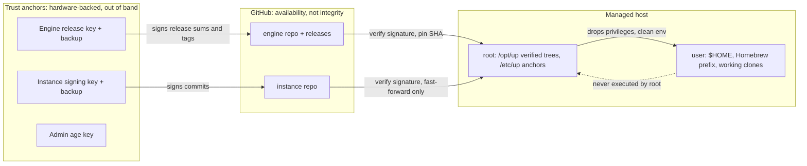

# Threat model

`up` runs as root on every host it manages, so whoever controls what `up` executes controls the fleet. This document states who could try to take that control, what each actor is allowed to achieve, and which requirements hold the line. Every design doc that touches root, the network or a credential is written against it.

## The invariant

**Root executes only code that is root-owned, verified against a trust anchor that git cannot change, and not older than what it last ran.**

Everything in [trust.md](trust.md) and [supply-chain.md](supply-chain.md) exists to keep this sentence true.

## Assets

| Asset | Where it lives |
| --- | --- |
| Root on every managed host | Granted to whatever `/opt/up` executes: the `up` binary, the engine tree, the instance tree, the toolchain |
| Secrets: vault contents, sops plaintext | Password manager vaults, sops files in instance history, decrypted material under `/run/up` during a run |
| Host identity keys: per-host age identity and deploy key | `/etc/up/age.key`, `/etc/up/deploy_key`, generated on the device |
| Trust anchors | `/etc/up/allowed_signers.engine`, `/etc/up/allowed_signers.instance`, `/etc/up/recipients.allow`, `/etc/up/known_hosts` |
| Maintainer signing keys | Hardware-backed SSH keys (primary and offline backup) for engine releases and instance commits |
| Personal data: hostnames, addresses, emails | Instance inventory, sops vars |

## Trust boundaries

## Actors

| Actor | Target outcome under this design | Mitigated by |
| --- | --- | --- |
| Engine tag or release pusher (stolen maintainer session, stolen PAT, malicious merged PR) | Nothing: hosts refuse unsigned or wrongly signed releases and moved tags | TRUST-05, TRUST-06, SUPPLY-03 |
| Instance pusher without the signing key (CI token, Renovate, a coding agent, a leaked PAT) | Nothing: hosts apply only commits signed by the anchored signer set | TRUST-07, CHG-11 |
| Instance pusher **with** the signing key (the maintainer, or a stolen hardware key plus PIN) | Root on every host within one schedule interval. **Accepted risk**, see below | TRUST-07, TRUST-11, SEC-15 backup signer and rotation |
| Local unprivileged code on a host (npm postinstall, editor extension, dev container with a `$HOME` mount) | That user's own data only; never root, never a machine token | TRUST-01, TRUST-02, TRUST-03, SEC-12 |
| LAN attacker | Denial of service only: no code or secrets via DHCP, TFTP or HTTP | IMG-11, TRUST-09, BOOT-09 |
| Network attacker who can block GitHub | A visible staleness alert, not a silent freeze | OPS-03, OPS-05, CHG-09 |
| Thief of an SD card or Pi | That host's secrets until revoked; no other host's secrets, no fleet-wide credentials | SEC-09, SEC-10, SEC-11, IMG-04, SEC-15 |
| Thief of the workstation | Bounded by hardware keys (touch and PIN) and disk encryption; no stored host private keys | SEC-10, HARD-05, CHG-06 |
| Compromised CI (engine or instance) | Cannot sign releases or commits that hosts trust | SUPPLY-02, SUPPLY-03, TRUST-07 |
| Prompt-injected coding agent | Can propose changes; cannot sign, bypass guard, or change recipients or signers | TRUST-12, PUB-13 |
| GitHub itself | Denial of service; cannot forge code hosts accept | TRUST-05, TRUST-06, TRUST-07 |

## Accepted risks

- **No release gate for the instance.** Hosts follow signed commits on `main`, not signed release tags, and there is no canary ring. Every commit the maintainer signs reaches every host within one schedule interval. Mitigations: required CI before merge, fast-forward-only application, the audit trail (OPS-02), and `git revert` as the normal rollback.
- **Raspberry Pi data at rest is unencrypted.** Pis have no practical full-disk encryption. A stolen SD card exposes that host's age key and the secrets encrypted to it. Mitigations: per-host scoping (SEC-04, SEC-11), shallow sparse instance checkouts (IMG-04), and fast revocation (SEC-15).
- **Netboot on a shared LAN.** If you can't isolate a provisioning VLAN, a rogue DHCP server can deny service to netbooting hosts. Signed iPXE scripts keep it from installing anything (IMG-11).
- **No MDM on macOS.** No remote wipe, no enforced OS updates, no FileVault key escrow. The personal recovery key is stored in the vault (HARD-05).
- **The interactive one-liner trusts `up.sh` from GitHub `main` over TLS.** High-assurance hosts use the verified install path or a rendered boot config, which pins `up.sh` by hash (TRUST-09).

## How this document is used

- Every requirement that runs as root, fetches from the network or handles a credential has at least one **negative** acceptance criterion: proof that a malicious input is refused (PUB-09 checks this).
- A new actor or asset means a new row here and a requirement that mitigates it, in the same PR.
