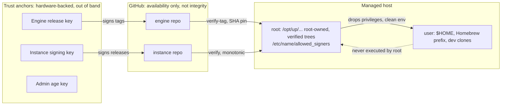

# `up` engine spec: security review

**Scope.** All 24 files in `up-engine-spec.zip`: README, AGENTS/CLAUDE, docs index, 11 design docs, decisions, glossary, open questions, roadmap, 2 prompts, 2 adapters.
**Date.** 2026-10-17.
**Perspective.** An adversarial review of the system as specified: trust boundaries, privilege transitions, key custody, supply chain, and fleet blast radius.
**Relation to the earlier review.** `claude/up-spec-review.md` covers design quality broadly. This document goes deeper on security. Findings marked **↺** reinforce or extend an item from that review. Everything else is new.

---

## 1. Bottom line

The spec has good security *instincts*. Tokens are kept out of argv, guard fails closed, bake forbids secrets, and there is a `fake` backend so CI never needs real credentials. What it does not have is a security *architecture*. There is no stated trust model. D-21 ("GitHub trusted") is the only sentence on the subject. Because of that, several privilege boundaries exist in the prose but are not enforced anywhere:

| What you probably believe | What the spec actually builds |
| --- | --- |
| Root on a host is protected from the user account | Root runs code, binaries and config from user-writable paths (S-01) |
| The instance is configuration | The instance is arbitrary code that runs as root on every host. Anyone who can push to it owns the fleet (S-03) |
| Engine releases are pinned | Tags are mutable and unverified. `up.sh` comes from `main` and is unverified. Netboot serves it over plain HTTP (S-02, S-08) |
| Each host only has its own secrets | Headless hosts hold vault-wide tokens and a shared deploy key, and the user layer needs those tokens too (S-07) |
| The workstation is just a convenient place to work | The workstation generates every host's private keys, holds push and become access to every host, the Talos admin config and the age admin key, and also runs npm installs and browser extensions (S-04, S-09) |

**Recommendation: do not start M1 code** until the spec includes a threat model and a short trust-anchor design (S-02, S-03). Those two items change paths, schemas and bootstrap ordering, and are expensive to retrofit. Most other findings are additive requirements that fit into M2, M3, M5 and M7.

### Top five, in order

1. **S-01** Close every path where root executes user-writable code. That means the checkouts, the Homebrew prefix, the uv/ansible toolchain, the pointer file, and the environment file the scheduler sources.
2. **S-02** Verify what hosts run. Use signed engine tags pinned by SHA, signed instance releases, and a hash-pinned `up.sh` in rendered boot configs. Anchor trust out of band, and refuse downgrades.
3. **S-03** Treat the instance repo as production code with fleet-root impact. Require hardware-backed signing and protected recipients, and don't let CI or Renovate approve their own changes.
4. **S-04 / S-07** Reduce key custody and blast radius. Generate keys on the device, keep the age identity separate from the SSH host key, and give each host its own deploy key and secrets scope.
5. **S-11** Add the missing security baseline: sudo policy, sshd, firewall, disk encryption, and security updates. A config-management system with a `security` role and zero security requirements will ship whatever the first implementer writes.

---

## 2. Trust model (proposed: add as `docs/design/threat-model.md`)

### Assets

| Asset | Where it lives in the spec |
| --- | --- |
| Root on every managed host | Granted to whoever controls engine code, instance code, or anything root executes |
| Secrets: vault contents, sops plaintext, k3s/Talos cluster credentials | 1Password/Bitwarden vault, sops files in instance history, decrypted files on hosts |
| Host identity keys (SSH host key, which is also the age identity) | Generated on the workstation, written into user-data, on disk on hosts |
| The maintainer's signing and auth keys | PM agent, YubiKey |
| Personal data (hostnames, addresses, emails) | Inventory, `up.yml` denylist, sops vars |

### Actors and what each one gets today

| Actor | Capability as specified | Should get |
| --- | --- | --- |
| Engine tag-pusher (maintainer account compromise, stolen PAT, malicious merged PR) | Root on every **new** bootstrap (newest `v*` tag, `main` for `up.sh`), and on every host after the next `up self update` | Nothing, without the release signing key |
| Instance pusher (any credential with write access, including CI tokens and Renovate) | Root on **every** host within one schedule interval | Nothing, without the instance signing key |
| Local unprivileged code on a host (npm postinstall, editor extension, compromised dev container with a `$HOME` mount) | Root at the next scheduled run (S-01); vault-wide token if the user layer can read it (S-07) | That user's own data only |
| LAN attacker | Rogue DHCP/TFTP takes over netbooting hosts; can sniff or race single-use credentials; can MITM first SSH contact with GitHub (S-08, S-06) | Denial of service only |
| Network attacker who can block GitHub | Holds hosts on stale config indefinitely and silently (exit `3`) (S-12) | Visible staleness alert |
| Thief of an SD card or Pi | Bootstrap token, the host's age key, full instance git history, and decrypted secrets (S-04, S-15) | That host's secrets, then revoked by the decommission runbook |
| Thief of the workstation | Every host key ever generated, push access to every host, age admin key, Talos admin (S-04, S-09) | Bounded by hardware keys and FileVault |
| GitHub itself | Everything (accepted in D-21) | Code integrity still verified against your own keys, so GitHub can deny service but cannot forge |

### Trust boundaries

The invariant to write down is: **root executes only code that is root-owned, verified against an anchor that git cannot change, and newer than what it last ran.**

---

## 3. Findings summary

| ID | Finding | Severity | Spec IDs touched | Owning milestone |
| --- | --- | --- | --- | --- |
| S-01 | Root executes user-writable code (several paths) ↺ | Critical | D-31, CHG-05, ARCH layout, PERF-05, BOOT-10 | M1 |
| S-02 | No authenticity or anti-rollback for code hosts execute ↺ | Critical | D-21, BOOT-04, CHG-03, CLI-09, IMG-07 | M1 |
| S-03 | Instance write access equals root on the whole fleet, with no governance | Critical | ARCH-03, CLI-01, SEC-05/08, CHG versioning | M1/M3 |
| S-04 | Host key material is generated, transported and stored too widely ↺ | Critical | SEC headless, IMG first boot, SEC-06 | M3/M5 |
| S-05 | Discovery can bind a host to the wrong instance ↺ | High | BOOT-06/07, Q-15 | M1 |
| S-06 | Token scope, lifetime and transport | High | BOOT-08, SEC-06, manual steps | M1/M3 |
| S-07 | Secrets blast radius and the system/user boundary ↺ | High | SEC table, SEC-03, CHG-05 | M3 |
| S-08 | Netboot is unauthenticated end to end | High | IMG-07, netboot section | M7 |
| S-09 | Control node concentrates fleet-wide power on a daily driver | High | control_node, CHG-06, IMG-08 | M7 |
| S-10 | CI and dependency supply chain ↺ | High | CHG-08, versions.yml, D-09, CLI design | M0–M2 |
| S-11 | No security baseline requirements | High | `security`/`ssh`/`users` roles, Q-11 | M2 |
| S-12 | Freeze, downgrade and detection gaps ↺ | High | CHG-07, CHG-10, CLI-03 | M2 |
| S-13 | Guard: a DLP aid treated like a control, plus leaky config ↺ | Medium | GRD-*, `up.yml` privacy/notify | M1/M3 |
| S-14 | macOS-specific privilege and TCC hazards | Medium | macOS role, scheduler, manual steps | M2 |
| S-15 | Baked image hygiene, provenance and physical theft | Medium | IMG-02, IMG first boot | M5 |
| S-16 | Dev container credential exposure ↺ | Medium | DEVC credentials, DEVC-06 | M6 |
| S-17 | Input validation, locks and file permissions | Medium | ARCH-05, CHG-05 | M0/M2 |
| S-18 | No lifecycle runbooks: decommission, lost device, key compromise ↺ | Medium | SEC | M3 |
| S-19 | AI agent assets can be steered to weaken controls | Low | AGENTS.md, prompts, PUB-07 | M4 |
| S-20 | Security is absent from the spec process | Low | docs/README, PUB-09 | M0 |

---

## 4. Findings

### S-01 Root executes user-writable code (Critical) ↺

The earlier review identified the engine and instance checkouts in `$HOME`. The problem is broader. Every one of these is a local privilege escalation from the user account to root:

| Path root executes or trusts | Why it is user-writable |
| --- | --- |
| `~/.local/share/up/bin/up`, `libexec/*`, roles; `/usr/local/bin/up` symlink | User-owned clone |
| `~/.local/share/<name>/roles`, `libexec`, plugins, `ansible.cfg` | User-owned clone. **Ansible also loads `ansible.cfg` from the current directory**, so a planted file can redirect plugin and callback paths |
| ansible-core and Python from uv | Installed under the user's `~/.local` by bootstrap step 3.4, which runs as the user |
| `sops`, `age`, `op`, `bws`, `gitleaks`, `chezmoi`, `mise` from Homebrew | **On macOS, `/opt/homebrew` is owned by the installing user by design.** A root run that resolves any of these from the Homebrew prefix runs a binary the user can replace |
| The pointer file `~/.config/up/config.yml` | If root's unattended run resolves the instance through the user's pointer, the user chooses which repo root converges, which is root code execution |
| The telemetry environment file | PERF-05's AC says it is "sourced … by the scheduler unit". If it lives in or is managed through `$HOME`, root sources user-controlled shell |
| launchd and systemd unit `ProgramArguments`/`ExecStart` | Point at the symlink into `$HOME`. This is the classic macOS LaunchDaemon escalation |
| Git hooks via `core.hooksPath` into the engine tree | Any root-run `git commit` (for example a future `up host set` that commits) runs user-writable hooks as root |

**Fix**
- Put the root toolchain in root-owned paths: `/opt/up/engine/<sha>`, `/opt/up/instance/<sha>`, a root-owned Python and ansible venv, and root-owned copies (or pinned, checksum-verified downloads) of `sops`, `age`, `gitleaks` and `git`. Don't put Homebrew on root's `PATH`. When the system layer has to drive Homebrew, it drops to the user explicitly. This also fixes Homebrew's refusal to run as root.
- Make root runs **hermetic**: `env -i` with a fixed `PATH=/opt/up/bin:/usr/sbin:/usr/bin:/sbin:/bin`, `HOME=/var/root` or `/root`, `ANSIBLE_CONFIG` set explicitly, and `cwd=/`. Read the instance location from `/etc/<name>/host.yml` or `/etc/up/config.yml`, never from the user's home.
- Drop privileges to the user layer with a clean environment (`runuser -u`, or `launchctl asuser` plus `sudo -u` on macOS). Nothing the user layer produces is read back by root.
- The user's working clones (`up self dev`) are separate checkouts. Promoting a dev engine to root use takes an explicit, interactive `sudo up self dev --activate` that copies the tree into `/opt/up`.

**New requirement (TRUST-01).** Every file root executes, sources or loads as configuration MUST be owned by root and not writable by any other user, along with every parent directory.
- AC: A test walks the resolved execution set (dispatcher, libexec, roles, plugins, interpreter, every binary root invokes, unit files) and fails on any non-root-owned or group/other-writable path.
- AC: The scheduled run refuses to start, and exits `1` with the offending path, if that check fails at runtime.
- AC: A planted `ansible.cfg` in the user's home and current directory has no effect on a root run.

---

### S-02 No authenticity or anti-rollback for what hosts execute (Critical) ↺

The chain of custody today:

1. `up.sh` comes from `raw.githubusercontent.com/<you>/up/main`. That is a mutable branch, with nothing verified beyond TLS to GitHub. Rendered cloud-init and netboot embed the same `curl … main … | bash`, and netboot serves `up.sh` over **HTTP**.
2. `up.sh` picks the "newest `v*` tag". Anyone who can push a tag (including a prerelease, see the earlier review's H2) chooses the engine for every new host.
3. `engine.ref` is a tag name. Tags move. CHG-03's AC (`git describe --tags`) passes on a moved tag.
4. Hosts follow instance `main`, unsigned, by default.
5. Nothing stops a downgrade. An attacker who can write `engine.ref` (instance push) can pin an old engine with a known bug.

**Fix: verify with tools already present.** Git 2.34+ verifies SSH signatures (`gpg.format=ssh`, `gpg.ssh.allowedSignersFile`) using only `git` and `ssh-keygen`, both already on macOS CLT and every target Linux. This keeps BOOT-01's "no new tools" rule intact.

- **Release key.** The maintainer signs engine release tags with a hardware-backed SSH key (`sk-ssh-ed25519`, verify-required).
- **`up.sh` anchor.** `up.sh` carries the engine's `allowed_signers` line as a constant next to `UP_ENGINE`, since a fork changes both together. It runs `git verify-tag` on the chosen tag before checkout, ignores prerelease tags, and refuses an unsigned tag. This shrinks the unverified surface to `up.sh` itself.
- **`up.sh` itself.** `up image render` and `netboot sync` embed `up.sh` **by content or by SHA-256**, fetched from a tag URL rather than `main`. For example: `curl -fsSLo /run/up.sh <tag-url> && echo '<sha256>  /run/up.sh' | sha256sum -c && bash /run/up.sh …`. The interactive one-liner stays convenient, and a documented "verified install" path (download, `ssh-keygen -Y verify`, run) is offered for high-assurance hosts.
- **Engine pin.** Pin `engine: {ref: v0.3.0, commit: <sha>}` (↺). `up update` verifies the tag signature **and** that the tag resolves to `commit`.
- **Instance.** Hosts follow **signed release tags**, not `main`. A canary ring may follow `main`, still with signature verification. Tags are signed locally by a human with a hardware key (`up release` can wrap this). Avoid both of these:
  - Trusting GitHub's web-flow signing key. That gives GitHub, or anyone with a merge button, signing power.
  - Having CI sign tags with a stored key. That turns CI compromise into fleet root.
- **Anchoring.** The instance `allowed_signers` is written root-owned to `/etc/<name>/allowed_signers` at provision time, from render. Later changes to it are accepted only from a release that verifies under the **current** signer set. Verify first, then apply. Never read the anchor from the tree being verified.
- **Anti-rollback.** Each host records the commit date and version of the last applied engine and instance release in a root-owned state file. Moving to an older one requires a local, interactive `--allow-downgrade`. This makes `up host set ref <old tag>` an explicit operator action and stops remote downgrades.

**New requirements**
- **TRUST-02.** Hosts MUST apply only engine tags with a valid signature from the engine signer set, and only when the tag resolves to the pinned commit.
  - AC: A moved tag, an unsigned tag and a tag signed by another key each make `up update` exit `1` without changing the checkout.
- **TRUST-03.** Hosts MUST apply only instance refs whose tip is signed by the host's anchored instance signer set. Changes to the signer set MUST themselves verify under the current set.
  - AC: An unsigned commit pushed to the followed ref is not applied, and the host logs and notifies.
- **TRUST-04.** Hosts MUST refuse to move to an older engine or instance release without a local `--allow-downgrade`.
  - AC: Setting `engine.ref` to an older signed tag in a new instance release makes the host exit `1` and notify.
- **TRUST-05.** Rendered boot configs MUST pin `up.sh` by hash, and netboot MUST NOT serve executable content over unauthenticated transport (see S-08).

---

### S-03 Instance write access equals root on the whole fleet, with no governance (Critical)

The spec describes the instance as "only what is theirs: `up.yml`, inventory, secrets, dotfiles". In practice the instance contains **code that runs as root on every host**:
- instance roles, which shadow engine roles, including `base`, `security` and `ssh` (ARCH-03);
- instance `libexec/`, which can shadow `up-guard`, `up-update` and `up-self` (CLI-01);
- Ansible plugins (vars, lookup, filter, module directories inside roles);
- `ansible.cfg`;
- `versions.yml` overrides, which choose what toolchain gets installed;
- chezmoi `run_` scripts and externals, which run as the user;
- `.sops.yaml`, which chooses who can decrypt future secrets.

Several things can write to it: the maintainer, CI (which tags releases), Renovate (which opens version-bump PRs), any coding agent working in the repo, and any credential with write access.

**Specific abuse cases**
- **Recipient injection.** A commit adds an attacker's age recipient to `.sops.yaml`. The next `up secrets add-host` or `rotate` runs `sops updatekeys` and re-encrypts every secret to the attacker.
- **Control removal.** An instance `libexec/up-guard` returns `0`, or an instance `roles/security` is empty. Both are silent.
- **Toolchain swap.** An instance `versions.yml` pins an older ansible-core or sops with a known vulnerability, or points a mirror at an attacker's proxy through `mirror:`.

**Fix**
- State in `overview.md` and the threat model: **instance write access is equivalent to root on every host.**
- Make guard, update, self, bootstrap, doctor and verification non-overridable (↺ H6). Report shadowed `security`/`ssh`/`base` roles in `up doctor` and in every converge log.
- Use CODEOWNERS and required signed review for `.sops.yaml`, `secrets/catalog.yml`, `roles/`, `libexec/`, `versions.yml`, `up.yml` (`engine`, `mirror`, `remote`) and `.upguard-allow`. With one maintainer, "review" means the host-side signature check from S-02, because that is the gate that matters.
- **Recipient allowlist.** Pin the expected age recipients (fingerprints) in the host-anchored trust file. `up secrets` refuses `updatekeys` when `.sops.yaml` names a recipient outside it, and instance CI diffs recipients on every PR.
- Renovate and CI may open PRs but MUST NOT merge or tag. Turn off automerge for anything that reaches hosts.

**New requirement (TRUST-06).** Changes to recipients, signers, the engine pin, mirrors or override code MUST be detectable before any host applies them.
- AC: Instance CI fails a PR that adds an age recipient not in the allowlist.
- AC: `up converge` prints every shadowed engine role and libexec command, and refuses to shadow the protected set.

---

### S-04 Host key material is generated, transported and stored too widely (Critical) ↺

- **Generated on the workstation.** `up secrets add-host` creates each host's SSH ed25519 private key on the workstation. The spec never says where it is stored or destroyed. A compromised workstation can therefore impersonate any server's SSH identity (MITM your own `up push`) and decrypt any host's sops files.
- **One key, two jobs.** The SSH host key is also the age identity. sshd reads it. Rotating the SSH host key forces re-encryption of secrets. Compromising the key gives both impersonation and decryption. Cryptographic key reuse across purposes is a recognized anti-pattern.
- **Transported in plaintext.** The private key and bootstrap token sit in `user-data`:
  - on the Pi's FAT boot partition, where it survives the scrub (↺);
  - on cloud VMs, in the metadata service for the instance lifetime, readable by **any local process or container on the VM** unless IMDS access is restricted;
  - possibly in `cloud-init` logs.
- **cloud-init may discard it.** `ssh_deletekeys` regenerates host keys after `write_files` (↺ C3), which breaks decryption.

**Fix**
- **Split the keys.** Use a dedicated age identity at `/etc/<name>/age.key` (root `0400`), separate from the SSH host key. Let cloud-init or the OS generate SSH host keys normally, and record them through `known_hosts` pinning instead of pre-generation.
- **Prefer on-device generation plus enrollment.** First boot generates the age key on the host and publishes the public recipient (to the console, a LAN enrollment endpoint, or a PR). The operator approves with `up secrets enroll <host>`, which runs `updatekeys` with the operator's key. The host converges the secret-free phases until it is enrolled. The private key never leaves the device.
- **Pre-generate only when you must.** For offline baked images, which need secrets at first boot, keep pre-generation. In that case: never write the key to disk on the workstation (stream it from the generator into the flash target); never store it in the password manager unless recovery requires it; and scrub every copy on the device after first boot, including `/boot/firmware/user-data`, cloud-init instance caches and logs.
- **Cloud VMs.** Don't put private keys or tokens in user-data. Require IMDSv2 with hop limit 1, or the equivalent, and fetch secrets through `push` or a one-time enrollment instead.

**Amend SEC-06** to say credentials MUST be removed on bootstrap exit whatever the outcome, and AC: no token or private key remains in `/boot*/user-data`, `/var/lib/cloud/**`, `/var/log/cloud-init*.log` or the journal, after both a successful and a failed first converge.

---

### S-05 Discovery can bind a host to the wrong instance (High) ↺

- **Collaborator and org repos match.** "List the login's repos" usually means `GET /user/repos`, whose default affiliation includes collaborator and organization-member repos. Anyone who can get the login added to an org or repo that has the `up-instance` topic creates a second match. If the user's own instance is missing (for example on a fresh account), it becomes the *only* match, and an unattended root converge runs a stranger's roles.
- **The SSH greeting reports one key's account.** It names the account of whichever key the agent offers first. A 1Password agent holding work and personal keys can resolve to the wrong login, and so can a forwarded agent in a container.
- **`--repo` accepts any URL,** including `http://` and local paths.

**Fix**
- Require `owner == login`. Require `--name` whenever more than one instance exists, and **never auto-select in unattended mode**: rendered configs always pass `--repo` explicitly, since render knows it.
- Use a namespaced topic (`up-instance-v1`) as a hint only, never as authorization (Q-15).
- Allow only `https://` and `ssh://`/scp-style remotes. Set `GIT_ALLOW_PROTOCOL=https:ssh`.
- Once trust anchors exist (S-02), discovery can only pick a repo. It cannot make a host trust one. A wrongly discovered instance fails `verify` against the anchored signers.

---

### S-06 Token scope, lifetime and transport (High)

- **The header goes to every URL.** `http.extraHeader` set through `GIT_CONFIG_*` applies to **every** HTTP request git makes in that process, including other hosts, submodules and LFS endpoints. Scope it with `http.https://github.com/<login>/<name>.git.extraHeader`, or use a credential helper that answers only for that URL.
- **The token is inherited.** `GH_TOKEN` and `GITHUB_TOKEN` are inherited by every child process: Ansible, Homebrew, mise, curl-pipe installers. Unset them as soon as discovery finishes (↺). Never pass them into the converge.
- **The token is too long-lived.** A "fine-grained PAT template" is tied to the maintainer's identity, and its minimum lifetime is days. Use a **GitHub App** with `contents:read` on the single instance repo. Render mints an installation token, which expires after one hour, into the boot config. This also gives per-host attribution in the audit log.
- **Netboot credentials** (S-08) and **Packer build credentials** follow the same rule: short-lived, single-repo, read-only.
- **First SSH contact is unpinned.** `ssh -T git@github.com` and SSH remotes on first boot will either prompt (and hang) or trust on first use (and accept a MITM). Ship GitHub's published SSH host keys as a root-owned pinned `known_hosts`, and set `StrictHostKeyChecking=yes` (↺).
- **Git version floor.** Root clones repositories. Several recent Git CVEs gave code execution at clone time through submodules and symlinks. Specify a minimum git version checked by `up.sh`, and clone with `--no-recurse-submodules`.

---

### S-07 Secrets blast radius and the system/user boundary (High) ↺

- **Vault-wide machine tokens.** One `op` service-account token or `bws` token per instance means every headless host can read every secret: other hosts' keys, the deploy key, cluster tokens. Scope a vault or project per class or per sensitivity tier. Keep host-unique material in sops only (↺).
- **The user layer needs the token too.** chezmoi's `onepasswordRead` and `bitwardenSecrets` run **as the user**. On a headless host, the machine token must then be readable by the user account, so any user-level compromise exfiltrates a vault-wide token. Pick one model and state it:
  - (a) Root resolves the user layer's secrets and hands chezmoi a pre-rendered data file in a per-run runtime directory (`/run/up/<uid>`, `0700`, removed at exit). The user never holds a token.
  - (b) The user layer gets its own narrower token.
  Option (a) is simpler and safer.
- **Shared deploy key.** One `instance_deploy_key` on every host means one stolen Pi gives fleet-wide read access, and revoking it breaks everyone (↺). Use per-host deploy keys or GitHub App tokens.
- **The `fake` backend fails open.** A host misconfigured with `secrets_backend: fake`, or a typo that falls through to it, converges with **known dummy values**: a dummy k3s token, dummy passwords. Allow `fake` only when an explicit CI marker is set (for example `UP_ENV=ci`), refuse it anywhere `/etc/<name>/host.yml` exists, and add a lint rule.
- **Leakage beyond `no_log`.** SEC-03 tests only `-vvv` output, so it misses these channels:
  - `no_log` is per task. A secret looked up in one task and rendered by a `template` task without `no_log` is printed by `--diff`, and `up converge --check` is the drift report users will run.
  - Facts set with `cacheable: true` persist in the JSON fact cache in plaintext. The cache location and permissions are unspecified.
  - Ansible's `.retry` files, `~/.ansible/tmp`, and failure messages that end up in the webhook payload (S-13).
  - Extend SEC-03's AC: run `--check --diff` and a failing task with the `fake` backend, and grep stdout, the journal, `/var/log/up`, the fact cache and the webhook capture for fake values.
- **Decrypted files.** Specify `/run/up/` (tmpfs, root `0700`, per-run subdirectory, removed in an `EXIT` trap). Never write them under `$HOME`.

---

### S-08 Netboot is unauthenticated end to end (High)

As written, the netboot path has three problems:
- DHCP options, TFTP for iPXE and HTTP for configs, `up.sh` and "per-host credentials". All of these are unauthenticated and unencrypted.
- A rogue DHCP server on the LAN wins the boot race and fully controls the OS any netbooting host installs.
- "Single-use" credentials only tell you an attacker sniffed or raced the fetch *after the fact*: the legitimate host gets a `404` and fails. Single use is detection, not prevention.

**Fix**
- Put netboot on an isolated provisioning VLAN with DHCP snooping, or accept the risk explicitly in the threat model.
- Build iPXE with an **embedded script and trusted certificate**. Fetch everything over HTTPS from the netboot server. Use iPXE `imgtrust`/`imgverify` to verify kernel, initrd and scripts against a signing key. Hash-pin `up.sh` as in S-02.
- **No secrets over netboot.** Use the on-device enrollment flow from S-04. If credentials must be served, bind each one to a per-host one-time URL with a short TTL. Alert, through the notify path, on a second fetch or on a fetch from an unexpected source.
- Amend IMG-07's AC: a fetch over plain HTTP is refused, and an unsigned iPXE script is refused by the client.

---

### S-09 The control node concentrates fleet-wide power on a daily driver (High)

`control_node` "most likely your daily-driver workstation" collects:
- SSH and become access to every host (`up push`);
- the Talos admin config and secrets bundle;
- image build and flash, which writes every host's boot media;
- the age admin key;
- every host's generated private key (S-04).

It also runs a browser, npm and pip installs, editor extensions, and coding agents.

**Fix**
- Make push keys hardware-backed (`ed25519-sk` with `verify-required`), so every push needs a touch. On targets, restrict them in `authorized_keys` (`from=`, `restrict`), and give push its own account with a scoped sudoers entry rather than reusing the human admin.
- Store `talosconfig` and the Talos secrets bundle sops-encrypted to the admin key. Never leave them in plaintext in `~/.talos`. Say so in IMG-08.
- Sign built images (for example with cosign or an SSH signature over the image digest) and verify the signature in `up image flash`, so a tampered image store cannot ship to SD cards.
- Recommend, but don't require, a dedicated control node (a small VM or a Pi) for users with more than a handful of servers.
- **k3s.** Distribute the **agent** token (k3s `--agent-token`) to `k8s_agent` hosts, and keep the server token on servers only. Today one `k3s_token` in `groups/k8s.sops.yaml` lets any compromised agent join as a server.

---

### S-10 CI and dependency supply chain (High) ↺

- **The public engine's GitHub Actions** is a primary attack surface and has no requirements. Add:
  - Third-party actions pinned by commit SHA.
  - Least-privilege `permissions:` on `GITHUB_TOKEN`, read-only by default.
  - No `pull_request_target` workflows that check out fork code.
  - No secrets exposed to fork PRs.
  - Releases built from a protected environment with required reviewers.
  - **No self-hosted runners for the public engine.** The Testing table runs VM tests on "a `control_node` host". If that ever becomes a self-hosted runner, a fork PR gets code execution on the fleet's most privileged machine.
- **`uv run --script` with inline dependencies** resolves from PyPI at run time, unlocked and unhashed, and S-01 has it running as root. Lock every script (`uv lock --script`), run with `--locked` or `--frozen`, and set an index allowlist. Q-03 (compiled binary) avoids this class of problem entirely.
- **Unhashed downloads** (↺ H9). uv, ansible-core wheels, gh, gitleaks, mise and the Homebrew installer need SHA-256 values in `versions.yml` next to each version, with verification as a MUST.
- **Base images.** Packer and pi-gen start from "a stock OS image". Verify vendor checksums and signatures (for example Ubuntu `SHA256SUMS.gpg`, the Raspberry Pi image SHA-256). Pin container base images by digest in the Dockerfiles.
- **Homebrew and mise.** Allowlist taps (official taps only by default; a third-party tap is arbitrary code). Pin security-relevant tools (sops, age, gitleaks, op) through checksummed downloads rather than rolling Homebrew. Prefer mise's aqua backend over asdf-style plugins, which are arbitrary shell from git, and evaluate mise's paranoid mode.
- **Renovate** may open PRs, but must never automerge anything that reaches hosts (S-03).
- **Vendored Ansible collections** are already pinned tarballs. Record their hashes too.

**New requirement (SUPPLY-01).** Every artifact fetched by bootstrap, converge or build MUST be verified against a pinned hash or a signature before it is used.
- AC: Corrupting one byte of any cached download makes the run exit `1` and name the artifact.

---

### S-11 No security baseline requirements (High)

The engine has roles named `security`, `ssh` and `users`, but no requirement constrains them. The behaviors that matter most in a fleet tool are undefined:

| Control | Gap | Proposed requirement |
| --- | --- | --- |
| sudo policy | The cloud-init user is in `sudo` with no password and no NOPASSWD statement. That either locks the user out of sudo or invites a blanket `NOPASSWD: ALL`, which makes any user compromise into root | Per-class sudoers policy. Workstations require a password or Touch ID (`pam_tid`). Servers allow NOPASSWD only where unavoidable, and `doctor` reports it |
| sshd | Not specified | `PasswordAuthentication no`, `KbdInteractiveAuthentication no`, `PermitRootLogin no`, `AllowGroups`, modern key types only. AC: an `sshd -T` golden test |
| Host firewall | Not mentioned | Default-deny inbound per class (nftables/ufw/firewalld; the macOS application firewall), with role-declared openings (k8s ports, NAS shares) |
| Security updates | Q-11 is open | Security updates MUST be applied automatically on every class (`unattended-upgrades`, `dnf-automatic` security, `softwareupdate` for critical items), separate from feature upgrades, with reboot coordination (↺ H5) |
| Disk encryption | FileVault is a manual step and never verified | `doctor` and converge verify FileVault or LUKS state and report it. x86 Linux uses LUKS with TPM2 enrollment. Pi is documented as unencrypted, with risk accepted in the threat model |
| macOS integrity | Not mentioned | Verify SIP and Gatekeeper are enabled, screen lock, and the firmware password or Activation Lock where applicable |
| Audit logging | Not mentioned | auditd or the unified log retained for privileged events. Every `up` run writes an audit record (see S-12) |
| Docker | The `docker` role exists | Membership in the `docker` group is root-equivalent. Prefer rootless or Podman, or document the root equivalence and keep the group off servers |

Add a `HARD-` prefix (or extend `SEC`) for these. Each needs a VM-test AC, and they belong in M2, not M8.

---

### S-12 Freeze, downgrade and detection gaps (High) ↺

- **Freeze attack.** Anyone who can block the instance remote (DNS, a captive portal, an upstream filter) makes every converge "offline", exit `3`, treated as success and silent. A host can run stale, vulnerable configuration indefinitely. The heartbeat and staleness alert proposed in the earlier review are therefore a **security** control, not just an operational one.
- **Online network failures exit `3`.** CHG-10 lets "any other task that fails for a network reason" record instead of fail. An attacker who makes a security task fail looks offline, not broken. Online, a failure is exit `1` (↺).
- **No audit trail.** There is no record of which engine and instance SHAs ran, when, who triggered the run, and what changed. Write a root-owned, append-only JSON-lines record per run (start, end, trigger, signer fingerprint verified, SHAs, exit code, changed tasks, skipped tasks). Ship it off-host through the heartbeat.
- **Notifications are failures-only.** Also notify on: a signature verification failure, a refused downgrade, a protected-control shadowing attempt, a guard bypass trailer, and "no full converge in N days".

---

### S-13 Guard: a DLP aid treated like a control, plus leaky config (Medium) ↺

- **Guard is advisory.** It runs client-side and is bypassable with `--no-verify`, `UP_GUARD_SKIP`, or by unsetting `core.hooksPath`. Treat it as a seatbelt, not a boundary. The boundary is GitHub **push protection** with secret scanning on both repos (server-side), plus redacted CI output (↺).
- **The denylist leaks itself.** `privacy.denylist` sits in plaintext in `up.yml`. **In a public instance, the denylist is a published list of the exact strings the owner wants hidden.** Store salted hashes of denylist entries, or keep the denylist in a sops file and decrypt it locally for scanning.
- **The webhook URL is a credential.** `notify.webhook` is plaintext in `up.yml`. Slack, Discord and most webhook URLs are bearer credentials, so a public instance publishes it, and anyone holding it can spoof alerts or flood the channel. Move it to the catalog. Redact payloads to exit code, host alias and failing task names, and include no task output.
- **Allowlist governance.** `.upguard-allow` entries need CODEOWNERS review. CI should fail when the count rises without a signed-off change, not just print the count.
- **Decrypting to scan.** Guard "decrypting sops vars locally" to build its hostname rules must keep the plaintext in memory only.
- **Visibility flip.** Changing private to public must force `up guard scan --history` under public rules, and block the flip on findings (↺).

---

### S-14 macOS-specific privilege and TCC hazards (Medium)

- **Full Disk Access to an interpreter.** FDA "for the scheduled binary": the scheduled binary is `bash` (`bin/up`) or `uv`'s Python. Granting FDA to an interpreter grants it to every script that interpreter runs. That is a TCC bypass for any malware that can run `bash`. A compiled, code-signed `up` binary (Q-03) is the only clean way to hold TCC grants. Otherwise, avoid features that need FDA in the scheduled path.
- **Unsigned profiles.** User-approved `.mobileconfig` profiles are unsigned in the spec. Sign them, and verify the installed profile's identifier and contents in `doctor`.
- **LaunchDaemon hygiene.** The plist must be `root:wheel 0644` in `/Library/LaunchDaemons`, and must point at a root-owned binary (S-01).
- **sudo keepalive.** "Ask for sudo once and keep it alive for the run", implemented as a background `sudo -v` loop, extends a cached credential that other same-user processes on the same TTY can use. Prefer one `sudo` invocation of a root-owned program that does all the system work and exits.
- **FileVault escrow.** With no MDM, recovery-key custody is undefined. Document storing the personal recovery key in the vault. State "no MDM: no remote wipe, no enforced OS updates" as an explicit non-goal (↺).

---

### S-15 Baked image hygiene, provenance and physical theft (Medium)

- **Sanitization is incomplete.** IMG-02 lists machine-id, host keys, cloud-init state, the build credential, history and local facts. Add:
  - `/var/lib/dbus/machine-id`, and empty `/etc/machine-id` rather than deleting it (↺);
  - systemd's random seed;
  - journald and `/var/log/*` (the build output may contain the credential);
  - `/root/.ansible`, `~/.ansible/tmp` and the fact cache;
  - Homebrew, uv and mise caches and config that can hold tokens (`HOMEBREW_GITHUB_API_TOKEN`);
  - `.git/config` and reflogs in both checkouts;
  - Packer's provisioner temp files.
  Scan the final **filesystem**, not only the history, with gitleaks or trufflehog in filesystem mode, and fail the build on findings.
- **Full history on every SD card.** A baked image carries the full instance git history: every sops ciphertext ever committed, encrypted to every recipient ever listed, plus the whole inventory and topology. A stolen SD card gives the attacker a complete offline copy. Bake a shallow clone of the release only, and consider a sparse checkout that excludes other hosts' `secrets/hosts/*`.
- **Provenance.** Sign produced images and verify in `flash` (S-09). Record the engine, instance and base-image digests in the image's metadata.
- **Physical threat.** Pis cannot protect data at rest without extra hardware. The threat model should say so and lean on per-host scoping and fast revocation (S-18).

---

### S-16 Dev container credential exposure (Medium) ↺

- **Agent forwarding exposes the agent to every process.** Any process in the container, including a malicious dependency's postinstall, can authenticate and sign as you. Require confirm-on-use: 1Password and Bitwarden agents prompt per use; with OpenSSH, use `ssh-add -c` or a dedicated key with `verify-required`. Consider a separate, lower-privilege key for containers.
- **Drop the read-only `~/.ssh` mount** for servers. Read-only still means readable private keys (↺).
- **Untrusted `.mise.toml`.** "Installs exactly those versions on create" from a cloned repo's `.mise.toml` executes that repo's tool definitions and tasks. Keep mise's trust prompt; don't auto-trust.
- **Unpinned images.** Pin images by digest in generated `devcontainer.json`, and sign published images.

---

### S-17 Input validation, locks and file permissions (Medium)

- **`name` is a path component.** It builds `/etc/<name>`, `~/.local/share/<name>`, unit names and image names. Constrain it in the schema (for example `^[a-z][a-z0-9-]{0,30}$`) so `../` or shell metacharacters can't reach path building or rendered units. Apply the same rule to `host`, `user`, `ref` (git ref rules), roles and MAC addresses, since all of these flow into cloud-init, kickstart, iPXE and systemd renderers. Add golden tests with hostile values.
- **Lock files.** Put the lock in `/run/up/lock` (root `0700` directory, `flock`), never in `/tmp`, where a symlink attack applies.
- **Permissions.** Specify modes for `/var/log/up` (`0750`, root:adm), `/etc/<name>` (`0755`), `host.yml` (`0644` is fine; it holds identity only after C4), `allowed_signers` (`0644` root), and the age key (`0400`). The inconsistency between `/etc/up/bootstrap-token` and `/etc/<name>/` should be resolved one way or the other.

---

### S-18 No lifecycle runbooks: decommission, lost device, key compromise (Medium) ↺

Add `up host retire` (↺) and three documented, tested runbooks:

| Event | Steps |
| --- | --- |
| Host lost or stolen | Remove its recipient; **rotate every secret it could read** (ciphertext in history is not protected by `updatekeys`); revoke its deploy key or App token and any machine token; remove it from inventory, netboot and the k8s cluster (delete the node, rotate the join token); notify |
| Workstation compromised | All of the above for every host whose key it generated; rotate the age admin key and the instance and engine signing keys; re-anchor `allowed_signers` on hosts through a signed release under a surviving key, or re-provision |
| Signing key compromised | Pre-register a **backup signer** in every `allowed_signers` (a second hardware key kept offline), so rotation works without touching each host |

Also specify a rotation cadence for machine tokens and the k8s join token.

---

### S-19 AI agent assets can be steered to weaken controls (Low)

The prompts tell agents to run `up` commands, commit and open PRs in repos whose content an attacker may influence: issues and PRs on the public engine, or files fetched during a task. An injected instruction can ask an agent to run `up guard allow`, set `UP_GUARD_SKIP`, or edit `.sops.yaml`.

**Fix**
- `up guard allow` and recipient or signer changes require an interactive TTY confirmation that an agent cannot supply.
- AGENTS.md states that agents never hold a secrets-backend session or signing key.
- Host-side signature verification (S-02) means an agent-authored change reaches hosts only after a human signs a release.

---

### S-20 Security is absent from the spec process (Low)

- There is no `threat-model.md`, no security requirement prefix, and SECURITY.md is listed but has no required content (reporting channel, supported versions, embargo process).
- **Add negative tests to the AC style.** Most current ACs prove the happy path. For each trust boundary, add an AC that a malicious input is refused: a moved tag, an unsigned commit, a user-writable file, a hostile `name`, a plaintext netboot fetch, a `fake` backend in production.
- Extend `plan-from-spec`'s "Gaps" step: flag any MUST that runs as root, fetches from the network, or handles a credential, but has no negative AC.

---

## 5. Proposed new requirements (summary)

| ID | Requirement | Milestone |
| --- | --- | --- |
| TRUST-01 | Root executes, sources and loads only root-owned, non-world/group-writable files; runs are hermetic | M1 |
| TRUST-02 | Engine tags signature-verified and SHA-pinned | M1 |
| TRUST-03 | Instance releases signature-verified against a host-anchored signer set; signer changes self-verify | M1 |
| TRUST-04 | Monotonic versions; downgrades need a local flag | M1 |
| TRUST-05 | Rendered and netboot entrypoints hash-pinned; no executable content over unauthenticated transport | M5/M7 |
| TRUST-06 | Recipient, signer, engine-pin, mirror and shadowing changes detectable and gated; protected subcommands and roles non-overridable | M1/M3 |
| SUPPLY-01 | Every fetched artifact verified by hash or signature | M1 |
| SUPPLY-02 | CI hardening: SHA-pinned actions, least-privilege tokens, no fork secrets, no self-hosted runners on the public engine, no automerge to host-reaching paths | M0 |
| SEC-09 | Per-host deploy credentials (GitHub App or deploy key); short-lived bootstrap tokens; URL-scoped auth header; env scrubbed after discovery | M1/M3 |
| SEC-10 | Secret scope per class; user layer receives pre-resolved data, never a machine token | M3 |
| SEC-11 | Separate on-device age identity with enrollment; no private keys in user-data or metadata | M3/M5 |
| SEC-12 | `fake` backend refused outside CI | M3 |
| SEC-13 | Secret non-disclosure across `--diff`, fact cache, logs and webhook | M3 |
| SEC-14 | `up host retire` plus tested lost-device and key-compromise runbooks, with a backup signer | M3 |
| HARD-01…08 | sudo, sshd, firewall, security updates, disk encryption verification, macOS integrity, audit logging, docker group policy | M2 |
| OBS-01 | Per-run audit record, heartbeat, staleness, and security-event notifications | M2 |

---

## 6. Open questions from a security lens

| Q | Security recommendation |
| --- | --- |
| Q-03 | **Compiled, signed single binary.** It removes unlocked PyPI at runtime, makes TCC grants safe on macOS, makes root-owned installation trivial, and simplifies verification. It is the highest-leverage security decision still open |
| Q-09 | If 1Password service accounts are available, scope one per class. If not, default headless hosts to `sops` or `push` and keep vault tokens off servers |
| Q-11 | Security updates automatic on every class; feature upgrades explicit with maintenance windows |
| Q-12 | Start private. Going public multiplies the impact of S-13 (denylist, webhook) and makes inventory topology an intelligence target |
| Q-13 | The webhook URL is a secret (catalog), and payloads are redacted. Add a dead-man's-switch receiver for heartbeats |
| Q-15 | Topic is a hint, `owner == login` is required, and unattended runs never auto-select |
| Q-10 | One admin username across hosts, with a separate non-human `up-push` account for the control node |

---

## 7. Recommended order of work

1. **Before M1 code.** Write `threat-model.md` (section 2). Amend architecture for root-owned trees and hermetic root runs (S-01). Add the trust-anchor design (S-02, S-03), the engine pin with SHA, and signed instance releases. These change paths, schemas and the bootstrap sequence.
2. **M0.** CI hardening (SUPPLY-02), push protection on both repos, SECURITY.md content, and schema validation patterns (S-17).
3. **M1.** TRUST-01 to TRUST-04, SUPPLY-01, discovery hardening (S-05), and token handling (S-06).
4. **M2.** The security baseline (S-11), observability and anti-freeze (S-12), and macOS specifics (S-14).
5. **M3.** The secrets model (S-07), key split and enrollment (S-04), lifecycle runbooks (S-18), and guard config fixes (S-13).
6. **M5–M7.** Image hygiene and signing (S-15), netboot authentication (S-08), and control node hardening (S-09).
7. **Throughout.** A negative AC for every trust boundary (S-20).
